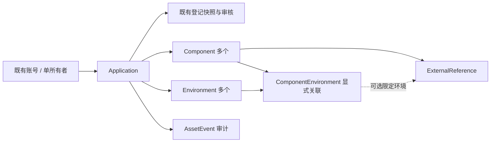

# P1-T01：最小应用资产与生命周期设计

- 日期：2026-10-14；代码基线：`8c5a06fd3a75cd4701f70100fdb356d3c2a03baa`。
- 状态：用户于2026-10-14同意按本方案开发；P1-T01-A/B/C已分批本地实现并通过隔离库、浏览器及容器验证；生产/默认开发库未迁移。未修改开发/生产数据库，未部署生产。
- 实施按资产数据/API、生命周期、工作台分批本地提交；形成可验收成果后再提PR。证据见[P1-A记录](../engineering/P1_ASSET_DELIVERY.md)。

## 1. 结论与边界

复用现有 `applications` 作为唯一应用身份，复用 `owner_user_id` 与 Better Auth 账号；新增组件、环境、组件环境关联和外部对象引用。资产是维护者的私有登记信息，不加入员工市场响应。没有 CI 接入的应用仍可登记和审核上架。

生命周期、市场登记审核、运行健康、部署结果分别记录。P1 的“运行中”是责任人登记的治理状态，不表示监控健康；登记仓库/流水线不表示已连通、不赋予 GitHub 权限，也不启动流水线或部署。

首轮保留单所有者；组件、环境继承应用所有者。责任团队只保存可选名称，不建团队成员/ACL 表，不由团队名称授权。多人维护、值班运维授权和外部 CMDB 双向同步另行设计。只登记已有 Web 应用，不扩展应用类型、低代码、论坛、P2审批中心或P4监控采集。

## 2. 已有实现与保持不变的规则

| 事实 | 当前代码依据 | P1处理 |
| --- | --- | --- |
| 应用、登记快照、审批事件已分表 | `src/db/schema.ts` 的 applications/appRevisions/reviewEvents | 复用，不复制另一套Application |
| 编辑/提交只允许有创建权的所有者；撤权后可读自己的历史 | `src/domain/app-service.ts`、`src/domain/actor.ts` | 资产读写沿用同一语义 |
| 批准事务锁应用、切换公开指针、写审计；禁止申请人自批 | `reviewRevision` | 保留，并补退役状态防护 |
| 普通员工读取LISTED且同应用APPROVED指针的白名单投影 | `listPublished` / `getPublished` | 不增加资产、负责人账号或生命周期未审内容 |
| 管理员下架/重新上架已实现 | `src/domain/community-service.ts` 的 manageListing | 复用，不能按旧设计文档误判“尚未实现” |
| API重新查session/账号状态，响应private/no-store | `src/domain/route.ts`、`src/lib/active-user.ts` | 新端点和直接Server调用都独立授权 |

更新复审期间旧公开版继续有效；资产编辑不改变 `app_revisions`、`published_revision_id` 或市场地址。所有已上架应用仍对所有已登录员工可见，不能因生命周期、团队或环境悄悄改为部门可见。

## 3. 最小数据结构

下表是拟议结构，不是已经生成的迁移。新资源实体有创建/更新时间，审计只有服务端事件时间；对象ID由服务端生成。key为应用内稳定标识，建议小写字母/数字/连字符、1–64字符；名称1–120字符，备注最多1000字符；未知字段拒绝。

| 对象 | 拟议字段 | 约束与含义 |
| --- | --- | --- |
| Application（既有表） | 保留现有字段；增加 `asset_version` 正整数默认1、`lifecycle_status` 默认UNKNOWN、`responsible_team_name` 可空（最多100字符） | owner仍是现有FK；私有治理信息，不复制市场名称/地址 |
| Component | `id, app_id, key, name, notes, archived_at` | 唯一(app_id,key)，另有唯一(app_id,id)供复合FK引用；前端/API是名称或备注，不是新应用类型 |
| Environment | `id, app_id, key, name, purpose, notes, archived_at` | 唯一(app_id,key)、唯一(app_id,id)；purpose为DEVELOPMENT/TEST/PRODUCTION，只表示登记用途，不授予环境执行权 |
| ComponentEnvironment | `id, app_id, component_id, environment_id, archived_at` | 唯一(app_id,component_id,environment_id)；显式绑定，不自动建立组件×环境的笛卡尔积 |
| ExternalReference | `id, app_id, component_id, binding_id可空, provider, resource_kind, repository_full_name, workflow_id可空, archived_at` | 首轮provider固定GITHUB；kind为REPOSITORY/WORKFLOW；仓库属于组件，流水线可选关联具体组件环境 |
| AssetEvent | `id, app_id, actor_user_id, action, resource_type, resource_id, before_state, after_state, reason可空, asset_version_after, occurred_at` | 专用资产/生命周期审计；不混用账号security_events或审批review_events |

Owner关系由 `Application.owner_user_id → user.id` 表达；不额外建立重复Owner表。组件和环境的有效负责人从应用继承，移交只修改一个根对象。P1不存凭据、Webhook secret、任意配置JSON或内网运行地址；已审批的市场访问地址仍属于登记快照。

### 关系完整性与外部引用

- 绑定使用 `(app_id,component_id)` 和 `(app_id,environment_id)` 复合FK，阻止把A应用组件绑定B应用环境；ExternalReference同样复合引用组件，非空binding再以 `(app_id,component_id,binding_id)` 引用对应绑定（需父表匹配唯一键）。服务端也检查父应用所有权和归档状态。
- 新表父外键采用RESTRICT，不新增应用硬删除入口；测试清理仅在独立fixture内按子表顺序执行。子对象不硬删除，只归档；key和绑定唯一性覆盖归档历史，恢复原ID，不用重建对象抹掉审计。归档父组件/环境前必须先归档依赖绑定与外部引用；恢复子对象时父对象必须未归档。
- 引用去重按组件、可空binding、kind、标准化repository_full_name、可空workflow_id；实现时显式处理NULL去重，不能依赖默认UNIQUE的NULL行为。
- WORKFLOW要求workflow_id为正十进制ID字符串；REPOSITORY的workflow_id必须为空。仓库全名只接受合法的owner/repo两段，不接受URL、路径穿越、用户信息或密钥。深链由服务端固定 `https://github.com/` 模板生成，不请求用户提供的URL。
- P1只登记引用，页面显示“已登记，未验证连接”；采集时间为null，健康/部署为“未接入”。不增加可由客户端填写的“CI成功”“健康”“已部署”字段。GitHub对象的实际存在性/访问权验证与采集留给P4。
- 真实公开演示引用可使用 `NoName4Me/enterprise-app-marketplace` / workflow `382348450`（本次只读API核对为t01-compatibility.yml）；测试夹具仍只用example.test账号，不写企业数据。

## 4. 权限与响应边界

所有权限还要求真实session、当前账号未停用且已完成首登改密。资源不属于当前用户时统一404；缺少写能力返回403。管理员能力来自服务端账号role，不能从请求体取值。

| 操作 | 普通员工/其他应用所有者 | 当前所有者有创建权 | 当前所有者创建权撤销 | 管理员非所有者 |
| --- | --- | --- | --- | --- |
| 员工市场与已发布内容 | 按现有规则 | 按现有规则 | 按现有规则 | 按现有规则 |
| 私有资产/生命周期/资产审计读取 | 404 | 允许 | 允许只读 | 允许专用治理入口 |
| 组件/环境/绑定/引用/团队名称编辑 | 拒绝 | 允许（非退役） | 403 | 不默认代编辑 |
| PILOT/ACTIVE/DEPRECATED登记变更 | 拒绝 | 允许 | 403 | 不默认代编辑 |
| 退役 | 拒绝 | 条件满足时允许 | 403 | 条件满足时治理操作 |
| 从退役恢复、移交所有者 | 拒绝 | 无治理特权则拒绝 | 拒绝 | 专用治理操作，理由必填 |
| 市场审核、下架/重新上架 | 按现有规则 | 不因此获得审批权 | 不因此获得审批权 | 保留已有能力及自批拒绝 |

管理员同时为所有者时，普通资产编辑仍需要创建权。团队名称、组件环境“负责人”显示和GitHub引用不会新增读写授权；P1没有“管理员天然能执行生产部署”的推论。

公开API投影保持原样；私有GET返回 `assetVersion` 与私有资产对象；聚合读以一个一致数据库快照读取根版本和子资源（单查询或只读REPEATABLE READ），避免返回新版version配旧版资产。请求不能写actor、owner、status、publishedRevision、审计时间等字段；仅专用生命周期动作接受合法目标阶段，专用管理员移交动作接受**候选**新owner ID，再由服务端核对目标账号与权限。

写操作使用既有同源/CSRF防护模式；新的Route Handler和Server Component必须调用同一资产领域服务，不能只在导航上隐藏入口。私有详情、搜索、列表和错误响应不进入共享公开缓存；公开搜索/推荐不联合查询资产表。

## 5. 生命周期与退役规则（设计建议）

| 状态 | 含义 | 与市场/运行的关系 |
| --- | --- | --- |
| UNKNOWN | 尚未登记；历史数据迁移默认 | 已上架也可UNKNOWN，不推断运行状态 |
| PILOT | 已有应用处于试点 | 若已上架仍向所有员工可见，不引入试点ACL |
| ACTIVE | 责任人登记为正式维护/使用 | 不表示健康、已部署或审核通过 |
| DEPRECATED | 计划退出、维护收缩 | 可仍LISTED；原批准内容/地址继续有效 |
| RETIRED | 治理登记已退役，留档只读 | 必须UNLISTED；不自动关闭目标服务或删除数据 |

首轮不做从零应用的PLANNED状态、不做通用可配置状态机。允许UNKNOWN→PILOT/ACTIVE/DEPRECATED，PILOT↔ACTIVE，PILOT/ACTIVE→DEPRECATED，DEPRECATED→ACTIVE。普通退役统一DEPRECATED→RETIRED，不跳过影响检查；RETIRED只能由管理员恢复到DEPRECATED，仍保持UNLISTED，资产仍归档，后续显式恢复和重新上架。

### 退役预检与执行

预检返回当前assetVersion、阻塞项和核查来源；没有外部采集时外部运行/依赖检查为UNKNOWN/NOT_CONNECTED，不能显示“无依赖、已关停”。执行时在锁内重新核查，不能信任旧预检。

必须同时满足：

1. 已是DEPRECATED且由管理员通过现有入口下架；公开指针及已批准历史保留。
2. 无DRAFT/PENDING申请；存在时返回409。首轮不实现撤回/删除待审快照来强行退役。
3. 所有组件、环境、绑定和外部引用均已归档；任何新关联会改变版本并使旧预检过期。
4. 操作者提交非空理由及 `impactAcknowledged=true`，明确人工核对使用者、外部依赖和目标系统处置。这是带actor/时间的**人工声明**，不是平台已验证外部资源关停；未接入的观测仍为UNKNOWN。

退役事务只改变生命周期与审计，不调用Docker/GitHub、不删除目标系统账号、不自动迁移数据。管理员恢复不自动重新上架；登记内容修改仍走草稿复审。DEPRECATED应用若需要向员工公告，通过既有登记内容更新/审核发布，不把私有备注直接投进公开详情。

所有者移交建议只由管理员执行：新owner必须为活跃、已改密、有创建权的账号；不得存在PENDING；理由与expectedVersion必填。允许DRAFT随应用移交，以便负责人停用后接管已有草稿。事务更新owner、根版本与审计，旧owner立即失去资源读取/写入资格；历史revision.created_by及审核记录不改。审核增加“当前应用owner不得审批”检查，同时保留“revision.created_by不得审批”，防止新owner为管理员时自批原owner创建、自己后续修改的草稿。

此建议的权衡是：支持草稿接管，但必须同步补强当前owner自批拒绝并增加回归；PENDING保持不可移交，不重新解释已提交快照的申请人。已有单owner、自批禁止与待审不可变的原则不变。

## 6. 事务、并发与审计

- 新人工资产写操作以应用行为事务边界，先按授权范围取得application行锁，再锁定相关账号并在事务中复查当前role/停用/创建权，然后按固定顺序检查子对象。账号状态读需要与撤权更新串行化（例如共享行锁），实现时与既有账号管理锁顺序核对。
- 每次人工变更携带正整数expectedVersion；锁内比较根asset_version，成功修改后根版本加1，失败409。子对象变更、归档、生命周期、移交均递增；未来运行采集不混入此版本。
- 同一次事务修改资源、根版本和AssetEvent。审计写失败全部回滚，不能出现状态成功却无事件。before/after只保存字段白名单与内部ID，不记录Token、邮箱、请求体或敏感备注全文。
- 锁顺序统一application→相关user（ID排序）→component/environment→binding/reference（ID排序）；审批/上下架也锁同一application。迁移后的创建草稿/编辑/提交/批准/重新上架均要拒绝RETIRED，防止老入口绕过冻结。
- Application数据库CHECK拟约束 `lifecycle_status <> 'RETIRED' OR listing_status='UNLISTED'`；活跃申请和子资源的跨表条件由锁内领域事务检查，不用跨表CHECK伪造保证。
- 普通保存/归档可通过expectedVersion阻止双击重复写入；重复生命周期动作、旧移交请求返回409，不新增第二条成功审计。不引入P5任务/消息幂等框架。

## 7. API与工作台

拟新增API均未实现；原 `/api/my/apps/:id` 是登记草稿编辑，不混入资产字段：

| 入口 | 行为 |
| --- | --- |
| `GET /api/my/apps/:id/assets` | owner私有聚合，含assetVersion、组件/环境/绑定/引用及归档筛选 |
| `PATCH /api/my/apps/:id/assets` | 只改责任团队名称；expectedVersion必填 |
| `POST /api/my/apps/:id/assets/{components,environments,bindings,references}`；`PATCH /api/my/apps/:id/assets/{resource}/:resourceId` | 小型明确资源动作，字段白名单；归档/恢复不硬删除 |
| `GET /api/my/apps/:id/lifecycle/preflight` | owner预检，不写数据；管理员走对应治理命名空间 |
| `POST /api/my/apps/:id/lifecycle/transitions` | to、expectedVersion、reason；退役另要求impactAcknowledged |
| `GET /api/my/apps/:id/asset-events` | owner可读本应用审计，分页；其他用户404 |
| `/api/admin/apps/:id/assets|asset-events|lifecycle/preflight` | 管理员只读治理视图 |
| `POST /api/admin/apps/:id/lifecycle/transitions|owner-transfer` | 管理员退役/恢复/移交专用动作，不提供任意资产PATCH |

保留 `/my/apps` 入口，列表分别展示“市场状态”“最新审核”“生命周期（登记）”，不合成一个绿灯。详情增加“市场登记 / 资产 / 生命周期与审计”分区；不重写市场首页或新增另一套Application后台。

资产页采用组件列表、环境列表及显式关联列表；空态为“尚未登记组件/环境/外部引用”，不自动生成default/prod。生命周期区显示变更理由、前置阻塞、人工声明边界与冲突后的重新读取操作。管理员治理页复用同一只读视图及受限动作；员工公开页不出现这些私有分区。

## 8. 历史兼容迁移与回退

1. **P1-A扩展**：只增加根asset_version、lifecycle_status默认UNKNOWN/值域与退役不可上市CHECK、可选团队字段、新资产表与AssetEvent；所有历史应用保留ID、owner、公开指针、快照和社区数据。无自动组件/环境回填，不从target_url推导prod或运行状态。
2. **P1-B生命周期**：开放生命周期转换服务；阶段A回填的历史LISTED、UNLISTED、待审、驳回均保持UNKNOWN，不能根据市场状态自动改阶段。旧字段和公开投影不变；启用生命周期前完成所有老写入口的RETIRED防护。
3. 迁移前在隔离DB用历史数据夹具记录应用ID/owner/公开指针、所有快照及事件行数；迁移后比对，并通过公开响应深度相等验证没有混入新字段。
4. SQL由锁定Drizzle生成/审查，先独立测试迁移，不使用schema push或修改旧迁移；约束失败应停止，不修删历史审批数据。受控维护窗口执行，无生产数据在本设计阶段被读取或迁移。
5. 回退优先保留新增表/字段、停用新入口，不drop数据；P1-B启用退役后，安全回退最低版本必须包含退役写入防护。回退到当前8c5a06f虽有数据库CHECK保护重新上架，却缺乏全部冻结检查，**不作为可接受的退役后运行回退**。恢复更旧数据库备份是独立受控操作，会影响之后的新写入，不能当常规回滚。

## 9. 分批实施与待确认建议

| 批次 | 最小实施内容 | 退出条件 |
| --- | --- | --- |
| P1-T01-A | 资产表/迁移、私有读写API、审计和并发版本；不开放生命周期动作 | P1-01/02对应API+DB用例，既有发布和权限回归保持通过 |
| P1-T01-B | 生命周期、预检、退役/恢复/移交及所有既有写入口保护 | P1-03、并发审批/退役、审计故障回滚、迁移回退验证 |
| P1-T01-C | 既有我的应用和管理员页中的资产/生命周期视图 | 多角色E2E、直接端点越权测试及完整CI |

用户已同意按本设计分批开发；本轮实现约定为：首轮单owner且管理员专用移交（允许DRAFT、禁止PENDING，同步加强新owner自批拒绝）、五状态最小生命周期、退役要求先下架/归档及人工影响声明、资产仅owner/admin可见。后续策略变更需更新本设计及对应验收；多人协作和生命周期对员工公开的方式不在本轮偷偷加入。

技术依据：[PostgreSQL16约束](https://www.postgresql.org/docs/16/ddl-constraints.html)支持复合FK，普通CHECK不能保障跨表状态，NULL去重需显式处理；[显式锁](https://www.postgresql.org/docs/16/explicit-locking.html)用于并发串行化；[GitHub workflow读取](https://docs.github.com/en/rest/actions/workflows#get-a-workflow)用于核对演示引用。本批未引入依赖或调用任何外部写API。

## 10. 本设计批次验证

2026-10-14本地实际执行：Markdown相对链接与代码围栏检查、`git diff --check`、`pnpm typecheck`、`pnpm lint`、`pnpm test`（4个文件、9项测试）、`pnpm build`全部通过。构建在同一基线的隔离工作区执行，使用测试占位配置，未连接实际数据库。

本批只修改设计、验收与交接文档；上述运行验证现有代码基线。新增资产/生命周期功能、数据库迁移与对应DB/E2E验收均NOT RUN。本地分支未推送、未创建PR，因此没有本批GitHub CI链接。

## 11. P1-A实现细化

稳定key、组件/环境关联与外部对象身份创建后不可原地改写；组件/环境PATCH允许名称、备注及环境用途，绑定/引用PATCH只允许单独归档或恢复。更换外部对象先归档旧引用再登记新对象，保留身份审计。读取返回全部对象及archivedAt，由后续页面筛选；事务持有application SHARE锁直到聚合读取结束，资产写入持有同一行UPDATE锁，保障版本与子资源一致。外部workflow ID无法作为文件名直接拼接网页地址，因此引用链接指向该仓库Actions页并独立保存ID；首轮不请求外部网络。

PostgreSQL16引用唯一约束使用NULLS NOT DISTINCT，锁定Drizzle0.45.4已支持；依据[官方约束API](https://orm.drizzle.team/docs/indexes-constraints)。资产审计保存内部ID、归档变化、枚举及变更字段名，不保存备注、名称、团队名称或仓库全文；有引用/审计的应用及审计actor受RESTRICT保护，需使用归档/停用而非硬删除。
